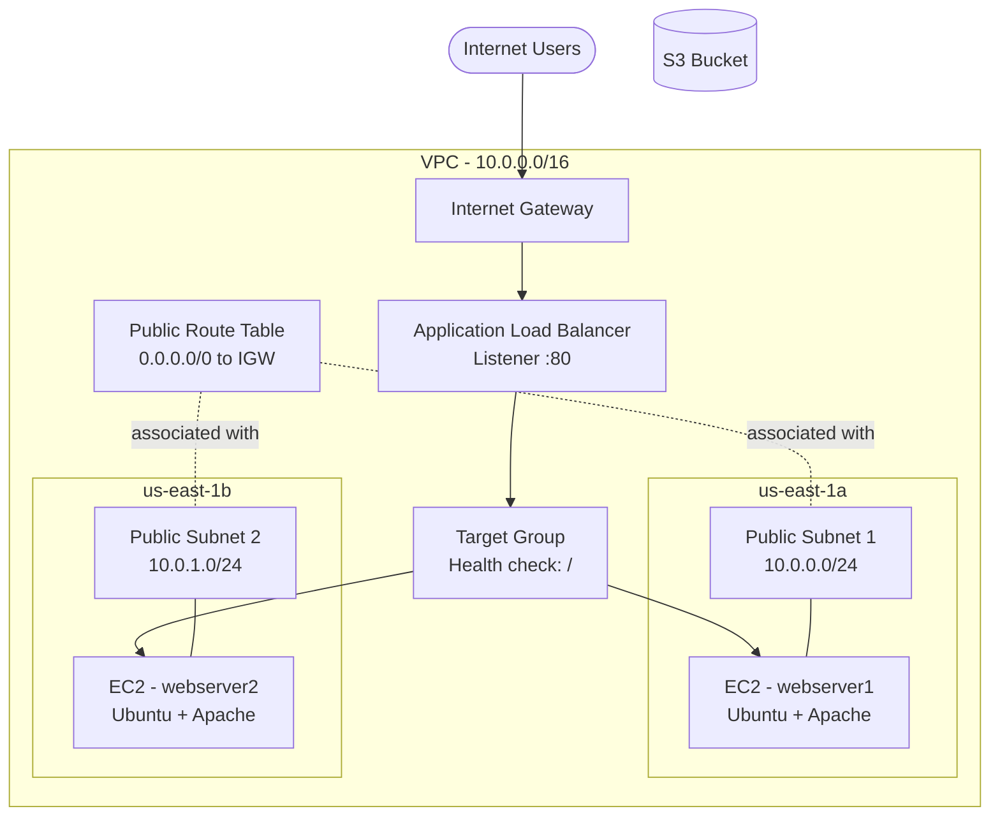

# Highly Available Web Infrastructure on AWS using Terraform

Infrastructure as Code (IaC) project that provisions a load-balanced, multi-AZ web application environment on AWS using Terraform. A single `terraform apply` builds the network, security, compute, and load-balancing layers from scratch, and a single `terraform destroy` tears everything down.


---

## Table of Contents

- [Overview](#overview)
- [Architecture](#architecture)
- [Features](#features)
- [Tech Stack](#tech-stack)
- [Project Structure](#project-structure)
- [Resources Provisioned](#resources-provisioned)
- [Prerequisites](#prerequisites)
- [Getting Started](#getting-started)
- [Configuration](#configuration)
- [Outputs](#outputs)
- [Verifying the Deployment](#verifying-the-deployment)
- [Cleanup](#cleanup)
- [Security Considerations](#security-considerations)
- [Cost Considerations](#cost-considerations)
- [Troubleshooting](#troubleshooting)
- [Future Improvements](#future-improvements)

---

## Overview

This project automates the deployment of a typical production-style web tier on AWS:

- A custom **VPC** with two public subnets spread across two Availability Zones
- An **Internet Gateway** and route tables for public internet access
- A **Security Group** controlling inbound and outbound traffic
- Two **EC2 instances** (Ubuntu + Apache) bootstrapped automatically through user data
- An **Application Load Balancer (ALB)** distributing traffic across both instances with health checks
- An **S3 bucket** provisioned for application assets

Each web server serves a different page, so refreshing the load balancer URL visibly alternates between the two instances and demonstrates load balancing in action.

---

## Architecture



**Traffic flow:** User, then Internet Gateway, then ALB listener (port 80), then Target Group, then a healthy EC2 instance in either Availability Zone.

---

## Features

- **Fully automated** provisioning and teardown with Terraform
- **High availability** through two subnets in two Availability Zones
- **Load balancing** with an Application Load Balancer, target group, and listener
- **Health checks** so traffic is only routed to healthy instances
- **Automated instance bootstrapping** via user data scripts (Apache install and custom web page)
- **Implicit dependency management** through resource references
- **Output values** that print the load balancer DNS name after deployment

---

## Tech Stack

| Category | Tool |
|---|---|
| Infrastructure as Code | Terraform (HCL) |
| Cloud Provider | Amazon Web Services |
| Compute | EC2 (`t2.micro`, Ubuntu) |
| Networking | VPC, Subnets, Internet Gateway, Route Tables |
| Load Balancing | Application Load Balancer (Layer 7) |
| Storage | S3 |
| Web Server | Apache2 |
| Scripting | Bash (user data) |

---

## Project Structure

```
.
├── provider.tf        # Terraform and AWS provider configuration
├── main.tf            # Core resources (VPC, subnets, SG, EC2, S3, ALB)
├── variables.tf       # Input variables
├── outputs.tf         # Output values (load balancer DNS)
├── userdata.sh        # Bootstrap script for webserver1
├── userdata1.sh       # Bootstrap script for webserver2
├── .gitignore         # Excludes state files and local Terraform directories
└── README.md
```

---

## Resources Provisioned

| Resource | Terraform Type | Purpose |
|---|---|---|
| VPC | `aws_vpc` | Isolated network (`10.0.0.0/16`) |
| Subnets (x2) | `aws_subnet` | Public subnets in `us-east-1a` and `us-east-1b` |
| Internet Gateway | `aws_internet_gateway` | Gives the VPC internet access |
| Route Table | `aws_route_table` | Routes `0.0.0.0/0` to the Internet Gateway |
| Route Table Associations (x2) | `aws_route_table_association` | Attaches the route table to both subnets |
| Security Group | `aws_security_group` | Allows HTTP (80) and SSH (22) inbound, all outbound |
| S3 Bucket | `aws_s3_bucket` | Object storage for the application |
| EC2 Instances (x2) | `aws_instance` | Apache web servers in separate AZs |
| Application Load Balancer | `aws_lb` | Internet-facing Layer 7 load balancer |
| Target Group | `aws_lb_target_group` | Pool of instances with health checks on `/` |
| Target Group Attachments (x2) | `aws_lb_target_group_attachment` | Registers each EC2 instance with the target group |
| Listener | `aws_lb_listener` | Forwards HTTP:80 traffic to the target group |

---

## Prerequisites

- An [AWS account](https://aws.amazon.com/)
- [Terraform](https://developer.hashicorp.com/terraform/downloads) installed (v1.0 or later recommended)
- [AWS CLI](https://docs.aws.amazon.com/cli/latest/userguide/getting-started-install.html) installed and configured
- An IAM user with permissions for EC2, VPC, ELB, and S3
- Basic familiarity with AWS networking concepts (VPC, subnets, route tables, load balancers)

Verify your installations:

```bash
terraform -version
aws --version
```

---

## Getting Started


### 1. Configure AWS credentials

```bash
aws configure
```

Provide your access key ID, secret access key, default region (`us-east-1`), and preferred output format.

> **Never hard-code credentials in Terraform files or commit them to version control.** Use `aws configure`, environment variables, or a shared credentials file.

### 2. Update region-specific values

The AMI ID in `main.tf` is specific to a region and account. Replace it with a valid Ubuntu AMI ID for your region:

```hcl
ami = "<your-ubuntu-ami-id>"
```

The S3 bucket name must be **globally unique**, so change it to something of your own:

```hcl
bucket = "<your-unique-bucket-name>"
```

### 3. Initialize Terraform

```bash
terraform init
```

Downloads the AWS provider plugin and prepares the working directory.

### 4. Validate and format

```bash
terraform fmt
terraform validate
```

### 5. Preview the changes

```bash
terraform plan
```

Review the execution plan. It should show every resource listed above as a `+` (create).

### 6. Apply the configuration

```bash
terraform apply
```

Type `yes` when prompted (or use `terraform apply -auto-approve` to skip the prompt).

---

## Configuration

### Variables

| Variable | Description | Default |
|---|---|---|
| `cidr` | CIDR block for the VPC | `10.0.0.0/16` |

Override a variable at apply time:

```bash
terraform apply -var="cidr=10.1.0.0/16"
```

### Network layout

| Component | CIDR | Availability Zone |
|---|---|---|
| VPC | `10.0.0.0/16` | n/a |
| Subnet 1 | `10.0.0.0/24` | `us-east-1a` |
| Subnet 2 | `10.0.1.0/24` | `us-east-1b` |

### Security group rules

| Direction | Port | Protocol | Source / Destination |
|---|---|---|---|
| Inbound | 80 | TCP | `0.0.0.0/0` |
| Inbound | 22 | TCP | `0.0.0.0/0` |
| Outbound | All | All | `0.0.0.0/0` |

### User data

Each EC2 instance runs a bootstrap script on first boot that:

1. Updates the package index
2. Installs Apache2
3. Queries the EC2 instance metadata service for the instance ID
4. Writes a custom `index.html` that displays the instance ID and a unique message
5. Restarts Apache

Scripts are kept in separate files and passed in with `(file("userdata.sh"))`.

---

## Outputs

After a successful apply, Terraform prints:

```
Outputs:

loadbalancerdns = "myalb-xxxxxxxxxx.us-east-1.elb.amazonaws.com"
```

Retrieve it again at any time with:

```bash
terraform output loadbalancerdns
```

---

## Verifying the Deployment

1. **Wait for the instances to initialize.** In the EC2 console, wait until both instances show `2/2 checks passed`. User data takes a few minutes to finish.
2. **Check target health.** In EC2, go to Target Groups, open `mytg`, and confirm both targets are `healthy`.
3. **Check the load balancer.** Confirm the state of `myalb` is `Active`.
4. **Open the DNS name** from the Terraform output in a browser.
5. **Refresh several times.** The page should alternate between the two web servers, confirming traffic is distributed across both Availability Zones.

You can also test from the command line:

```bash
curl http://$(terraform output -raw loadbalancerdns)
```

---

## Cleanup

To avoid ongoing charges, destroy all resources when you are finished:

```bash
terraform destroy
```

Or skip the confirmation prompt:

```bash
terraform destroy -auto-approve
```

> The Application Load Balancer is billed hourly, so do not leave this environment running.

---

## Security Considerations

This project is intended for learning and demonstration. Before using a similar design in production, address the following:

- **Restrict SSH access.** Port 22 is open to `0.0.0.0/0`. Limit it to your own IP address or remove it and use AWS Systems Manager Session Manager.
- **Use separate security groups** for the load balancer and the instances. Instances should only accept HTTP from the ALB's security group.
- **Use private subnets** for application servers, with only the ALB in public subnets and a NAT Gateway for outbound access.
- **Enable HTTPS** with an ACM certificate and an HTTPS listener (port 443), redirecting HTTP to HTTPS.
- **Never commit state files or credentials.** `terraform.tfstate` can contain sensitive data. Make sure it is covered by `.gitignore`.
- **Follow least privilege** for the IAM user running Terraform.

### Recommended `.gitignore`

```gitignore
# Terraform
.terraform/
*.tfstate
*.tfstate.*
crash.log
*.tfvars
override.tf
override.tf.json

# Keep the lock file committed
!.terraform.lock.hcl
```

---

## Cost Considerations

| Resource | Cost note |
|---|---|
| EC2 `t3.micro` (x2) | Free tier eligible |
| Application Load Balancer | Billed per hour plus usage, **not** free tier for all accounts |
| S3 bucket | Negligible when empty or lightly used |
| VPC, subnets, IGW, route tables | No charge |

Always run `terraform destroy` after testing.

---

## Troubleshooting

| Problem | Likely cause | Fix |
|---|---|---|
| `Duplicate resource` / `already declared` on validate | Two resources share the same type and local name | Give each resource a unique local name |
| `Unsupported argument` or `type of tags not expected` | Missing `=` or wrong syntax | Use `tags = { ... }` and check the provider docs |
| Bucket creation fails | Bucket name is already taken globally | Choose a different, unique name |
| `InvalidAMIID.NotFound` | AMI belongs to a different region or account | Use an AMI ID valid for your region |
| Load balancer URL times out or returns 502/503 | Targets still initializing or unhealthy | Wait for 2/2 status checks and healthy targets; check the security group and Apache |
| User data did not run | Script error | Test the script locally; check `/var/log/cloud-init-output.log` on the instance |
| Plan shows stale values | Files not saved | Save all files before running Terraform |
| Authentication or `UnauthorizedOperation` errors | IAM user lacks permissions | Attach the required policies to the IAM user |

---

## Future Improvements

- [ ] Create an **IAM role and instance profile** so EC2 can read from the S3 bucket
- [ ] Move instances to **private subnets** with a **NAT Gateway**
- [ ] Split into **separate security groups** for the ALB and EC2 instances
- [ ] Replace static instances with an **Auto Scaling Group** and **Launch Template**
- [ ] Use `count` or `for_each` to remove duplicated resource blocks
- [ ] Fetch the AMI dynamically with a `data "aws_ami"` block
- [ ] Parameterize region, instance type, and CIDRs through variables
- [ ] Configure a **remote backend** (S3 with DynamoDB state locking)
- [ ] Refactor into reusable **Terraform modules** (`vpc`, `compute`, `alb`)
- [ ] Add **HTTPS** with ACM and a custom domain through Route 53
- [ ] Add a **CI/CD pipeline** (for example GitHub Actions) to run `fmt`, `validate`, and `plan`

---

# 👩‍💻 Author

**Neha V M**

- GitHub: https://github.com/Neha-V-M
- LinkedIn: https://www.linkedin.com/in/neha-v-m/

---

⭐ If you found this project useful, consider giving it a **star**.
